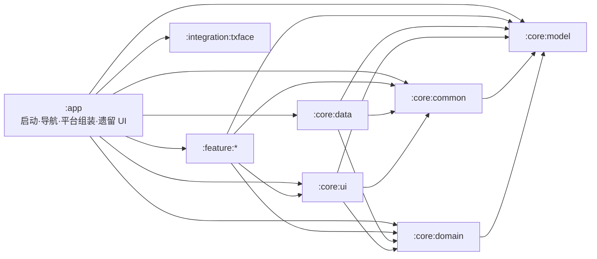

# 系统架构概览

最后核对：2026-10-23（定位前台服务增加业务期间的 CPU 唤醒锁；拔线锁屏效果以对应构建验证为准，其他模块非本轮全量业务运行验收）

本文描述当前代码实际运行形态，不把目标架构写成已经完成的事实。版本和依赖见[技术栈与构建基线](tech-stack.md)，产品行为见[产品概览](../product/overview.md)。

## 总体形态

LongCare 是单应用、多模块的 Compose Android 应用。当前采用“壳层 + Core + 部分 Feature 下沉”的过渡架构：

- `:app` 负责 Application/Activity、隐私和会话入口、类型安全导航、Manifest 组件、平台/厂商 SDK 适配，以及仍未迁出的多数 route-bound UI。
- `:feature:carddiagnostics` 提供本地 NFC/R65C UI，登录页中央大 Logo 长按确认后进入，平台读卡监听在 `:app`。
- `:integration:txface` 统一拥有腾讯人脸 SDK；本地 AAR 通过两个纯 artifact wrapper 模块供 Android library 消费。
- `:core:*` 提供模型、领域契约、数据实现、通用 UI 和基础设施。
- `:feature:*` 已承接部分业务状态、用例、平台能力或 UI，但模块迁移尚未完成。
- `:baselineprofile` 提供启动测量及 Profile 生成；当前生成器仅有启动、盲滑和返回操作，尚未建立登录后业务旅程断言。



箭头表示允许出现的项目模块依赖；每个模块的精确白名单以 `scripts/quality/module_dependency_allowlist.txt` 为准。

## 模块职责与现实归属

| 模块 | 当前职责 | 当前现实/迁移状态 |
|---|---|---|
| `:app` | 运行时壳、导航、Manifest、平台网关、厂商 UI 控制器、更新任务 | 仍包含护理、销售、NFC、倒计时等大量业务 UI；legacy feature 目录已冻结新增 |
| `:feature:carddiagnostics` | NFC/R65C 本地检测 UI | 不依赖 Data、会话或业务事件总线 |
| `:integration:txface` | 腾讯人脸 SDK adapter、依赖与规则 | `FaceVerifier` 契约不泄漏厂商类型 |
| `:baselineprofile` | Macrobenchmark 旅程与 Baseline Profile 生成 | 使用 Pixel 6 API 33 managed device，目标为 `:app` |
| `:core:model` | 跨层模型、值对象、`ApiResult`、序列化模型 | Kotlin/JVM 模块，不依赖 Android framework |
| `:core:domain` | Repository/网关契约和领域规则 | Kotlin/JVM 模块，不依赖 Android framework 或数据实现 |
| `:core:data` | Retrofit、Room、DataStore/COS 相关实现、Repository 实现和 Hilt 绑定 | 数据实现集中地；不得依赖 feature/UI |
| `:core:common` | 日志、诊断、运行配置、调度器、图片输出/受管文件、通用 Android 能力 | Android library；不是纯 Kotlin 模块 |
| `:core:ui` | 共用 Compose/UI 支撑、共享 ViewModel、统一图片预览及通用按钮文案 | 可依赖 Core 契约，不得访问数据实现 |
| `:feature:login` | 登录 ViewModel、动作接口、DI 和 feature entry | `LoginScreen` 仍在 `:app` |
| `:feature:home` | 首页共享状态、可见期设备状态轮询、上报能力、动作接口和 feature entry | 护理/销售首页 route UI 仍在 `:app` |
| `:feature:identification` | 身份用例/网关、状态编排、CameraX + ML Kit 人脸采集和默认比对页 | 已拥有默认、手动采集、备用腾讯人脸 UI；`IdentificationScreen` 主页面仍在 `:app` |
| `:feature:location` | 定位 Service、管理器、会话、上报、诊断 | 作为服务流程内嵌能力，没有独立路由 |
| `:feature:photoupload` | 上传门面、任务队列、标准相机/水印与照片处理状态 | `PhotoUploadScreen` 仍在 `:app`；`CameraScreen` 已共享 |
| `:feature:servicecountdown` | 倒计时状态、轮询和平台网关契约 | route UI 与系统闹钟实现在 `:app` |

## 启动与会话

1. `MainActivity` 使用 Hilt，启用 edge-to-edge，并把 UI 交给 `MainApp`。
2. 未同意隐私政策时只显示同意弹窗；同意后执行需要用户授权的后置初始化。
3. `MainViewModel` 暴露持久会话：
   - `Unknown` → 启动进度页
   - `LoggedOut` → `LoginRoute`
   - `LoggedIn` → `HomeRoute`；恢复前校验账号身份，退出或换号清理旧栈
4. 全局 `SessionInvalidationHandler` 负责失效提示与退出；业务页面不各自实现一套登出导航。
5. WorkManager 启动任务检查新版本；UI 只观察最新一次启动请求，避免历史成功任务重新弹出旧更新。版本检查仅对连接、超时及 HTTP 408/429/500/502/503/504 最多重试两次；空数据等无效响应和未知异常直接结束本次任务，保留 attempt、errorKind、httpCode、willRetry 诊断。空数据未被定义为“无更新”，不放宽其他接口契约。

## 导航组装

导航使用 Navigation 3 的可序列化 NavKey、唯一 entry ID 和可保存单栈，由 NavDisplay 管理页面生命周期，并在 `:app/navigation` 统一注册：

- Entry：登录、Home 和订单列表；首页、计划和记录列表显式共享 Home entry 的 TodayOrderViewModel owner。
- 护理首页设备状态由独立 `HomeDeviceViewModel` 调用 Domain `HomeDeviceRepository`，Data 层只透传禁缓存的状态接口。轮询协程由首页页签选中与 `RESUMED` 双条件管理，不放入常驻服务或全局作用域；周期从请求起点计至少 5 秒，单请求串行，慢请求不追赶补发。暂停轮询只取消网络工作，同一会话保留最后成功状态，返回静默刷新；失败不隐藏已有卡片。ViewModel 内仅保留不发请求的会话监听，退出、换号、令牌或账号归属变化时先清空，再取消旧请求，结果发布前复验取消状态和当前会话；姓名、头像更新不重启轮询。销售和未登录会话不请求。安装示意/预览仅接受 HTTPS 地址并复用无原生标题栏的普通 `WebViewRoute`，不启用销售评估或客户详情桥接。
- Sales：客户/提醒、登记、评估选择、设备和结果使用 `SalesRoute`，每个 entry 独立持有 SalesViewModel；扫描与进度在同一设备 entry 中展示。
- Service flow：服务详情、护理执行、NFC、选择服务、照片上传、倒计时、结束选择、完成摘要。
- Support：用户列表/记录、身份与默认人脸核验、相机、手动人脸采集和 WebView；旧设备选择页、人脸引导页及正式应用腾讯测试路由已移除。

所有应用内 H5 共用 `WebViewScreen` 与 `NativeBridge`；隐私网页以 Dialog 包裹同一容器，
启用 JavaScript 但关闭仅映射到网页 dismiss，不触发隐私同意/拒绝。统一关闭接口为
`window.NativeBridge.closeWebView()`；评估容器额外启用 `enterUserDetails(pingguuserid)`，替换 H5 为客户详情，同客户来源仅弹出并刷新。两个方法共用主线程、前台生命周期、单次导航及路由 entry 校验。
内部 H5 不设置额外 URL 白名单或导航拦截；新增方法直接放入 NativeBridge 并显式添加注解，不使用通用分发框架。

订单相关路由传递轻量 `OrderNavParams(orderId, planId)`，页面再通过 Repository/共享状态加载业务数据。跨页面结果使用 entry ID 定向的可保存邮箱，保留原 key 与 StateFlow 契约；消费会发出空值，图片 map 只编码文件引用和元数据。来源已离开的回调不可修改新栈。服务完成保留 Home、移除执行中间页，普通返回到首页。

当前只有 login、home、identification 三个 feature entry 常量进入运行时 registry；registry 的数量校验不是完整路由清单。完整页面映射见[页面与路由地图](ui-and-screen-map.md)。

返回必须使用当前 entry 出栈，不得用固定目标 navigate 或重建页面模拟返回。前进才压栈；登录态切换、业务已完成页面替换等特殊场景须明确移除范围并测试保留的 entry 序列。销售登记填写→确认、确认成功→提交结果、设备上传成功→评估结果使用替换；失败不导航。结果页数据归属自身 entry，打开另一客户详情不清空或覆盖它。

## 状态与异步约定

- 可持续渲染状态使用 `StateFlow`，Compose 使用 `collectAsStateWithLifecycle()`。
- 会触发导航或用户可见结果的重要动作必须可确认消费，避免用 `SharedFlow(replay = 0)` 承载不能丢失的事件。
- replay-zero 流只用于允许观察者缺席时丢失的实时输入或诊断信号，例如 NFC/RFID 瞬时事件。
- 协程取消必须继续抛出 `CancellationException`；敏感流程由质量脚本扫描。
- ViewModel 不持有 Activity；需要 Activity、Context、Service、闹钟、安装器或厂商 SDK UI 时通过 app-owned gateway/controller。正式开始服务不保留页面导航回调：项目保存由 ViewModel 完成，成功状态保留订单和项目快照，当前页面恢复到 RESUMED 后导航并确认消费；已确认服务端成功时，本地保存失败不引导重复开始。详情加载只接受当前请求，旧请求取消后的结果不得覆盖新订单。
- Repository 会话写入为 suspend 操作，调用者不能在 DataStore 持久化完成前报告登录/退出成功。

## 数据与持久化

- Retrofit + Moshi 承载 LongCare API；API 方法、路径、参数注解和关键 JSON 字段由契约测试保护。
- 正式 Moshi 由 `:core:data` 的 DI 配置提供；`DefaultMoshi` 仅在 App 测试源集中使用。
- Room 当前 schema 版本为 3，schema JSON 保存在 `app/schemas`。`DatabaseModule` 仅允许从已确认的 v1/v2 破坏性重建；v3 及后续版本缺少迁移路径时拒绝打开，不再无条件清表。测试覆盖历史版本重建、正常重开保留本地进度/照片，以及未知版本打开失败后记录仍保留。后续 schema 变更必须提交保留本地状态与未上传照片的 Migration 和升级测试。
- 订单详情统一通过 `OrderDetailRepository` 读取；`OrderRepository.getOrderInfo` 委托其强制刷新路径。请求保留 `orderId/planId`；刷新成功同步 Room 后才写内存缓存。订单内存缓存与腾讯凭据共用 `UserSessionTracker` 的会话代次，退出、换号、令牌变化和重新登录时清空，旧请求不能回填新会话缓存。
- DataStore 保存会话、偏好和少量兼容记录。
- WorkManager 用于启动更新检查、APK 下载等需要跨重建继续或恢复结果的任务。
- 腾讯 COS 负责业务图片/文件上传，Feature 通过 `PhotoCloudUploader` 等受校验门面使用。
- Debug 可选的本地 mock 只存在于 debug source set，不进入 Release。

## 图片与人脸链路

- 标准业务照片统一进入 `CameraRoute`，由 `UnifiedImagePipeline` 完成 EXIF 方向修正、水印、JPEG 压缩、原子写入、大小校验和受管文件生命周期。
- `ImageProcessingPolicies` 集中维护图片参数；业务页面不得各自硬编码压缩策略。
- `PhotoPreviewDialog` 是通用全屏预览实现。
- 订单图片行删除与受管文件删除在数据层耦合，单张删除、整单清理和完成流程使用同一生命周期。
- 照片必须先建立 Room 记录；插入失败保留受管文件和失败任务，重试先补插入，不将 UUID 当作已持久化订单图片。上传后的云端 key 必须完成命中实际行的 Room 更新，再更新内存成功状态和发布页面结果；写入失败保留可重试状态及本次云端 key，初始化查询与插入/删除交错不能丢失、重复或复活本地任务。
- 默认服务人员核验由 `:feature:identification` 的 CameraX/ML Kit 流程完成：单人/姿态检查 → 建立睁眼基线 → 闭眼 → 稳定睁开 → 拍摄 → 编码 → `/V1/User/CheckFace`。
- 服务端登记照只作为“是否需要补录”的权威状态，不重新下载为客户端本地缓存；旧版遗留文件在需要补录时清理。
- 腾讯人脸 SDK 和手动采集仍保留兼容/验证路径，但不是默认订单核验入口。手动采集仅在 CameraX 绑定成功后开放拍摄，缺失相机或同步派发失败必须退出加载态，重复点击不重复采集；页面销毁后忽略迟到的初始化，只释放自身用例。
- 腾讯 AppSecret 不进入普通系统配置缓存或 UI 状态：保存、恢复和刷新配置时只保留公开第三方字段，旧嵌套 JSON 在读取时重写；配置请求禁止 HTTP 缓存。Access Token 缓存未命中时，由数据层重新请求现有配置接口，短暂提取 AppSecret 换取 token。
- Access Token/SIGN ticket 按 AppId 与登录会话代次在内存中缓存，保留过期安全窗口和并发合并；NONCE ticket 每次认证独立请求。退出、换号、令牌变化及重新登录会清空缓存，旧异步响应、界面请求和 SDK 延迟回调不再生效；SDK 成功后的底图上传也在挂起边界检查原会话，失效后不继续登记或更新认证成功状态。核验对象 userId 可以是老人，不与操作员 userId 混同。
- 腾讯 SDK 启动自身 Activity 会使宿主进入 `onStop`，该事件不释放认证；资源在认证结束、所属 UI 销毁或登录会话失效时释放。客户端仍会收到 AppSecret，剩余安全边界见[工程风险](../analysis/project-review.md#腾讯人脸凭据)。

## Android 组件边界

最终组件来自 app、feature Manifest 和 AAR 合并：

- Activity：
  - `MainActivity`
  - `CountdownAlarmActivity`
  - QLZ SDK 的内部 `MainLoadingActivity`
- Service：
  - 订单定位 `LocationTrackingService` 和 AMap `APSService`（`location` 类型）
  - 响铃 Service（`mediaPlayback`）
- Receiver：倒计时、关闭响铃、服务结束提醒和设备启动恢复。
- Provider：受限 `FileProvider`；WorkManager 默认 initializer 被移除，改为应用自定义配置。

主应用不新增检测 Activity 或检测 Launcher；登录页中央大 Logo 长按确认后在既有 NavDisplay 内打开读卡页，不使用传感器或震动。NFC Reader Mode 只回调当前页面，退出即释放，不向业务事件总线派发。SDK 内部 Activity 不导出。

## 权限与平台约束

- 相机、人脸、NFC、蓝牙、定位、通知、精确闹钟、全屏提醒和应用安装均按业务入口请求，不应在 Application 无条件触发。
- Android 14+ 的前台服务类型及对应权限在 Manifest 中显式声明；定位 Service 只能在满足位置服务和运行时权限的用户可见流程中启动。
- 倒计时入口只检查位置、通知、定位开关、提醒渠道/渠道组、精确闹钟和 Android 14+ 全屏提醒，并说明受影响功能；用户明确确认后才分项请求运行时权限或打开设置。定位请求仅包含精确与大致位置，通知单独申请。NFC 与销售的定位用途说明保留用户主动进入应用权限设置的入口；拒绝回调仅结束本次操作，不根据 rationale=false 猜测永久拒绝，也不自动弹设置劝导。每次授权或设置返回重读系统状态，仍缺少同一项时结束本轮提示，用户可从后台设置主动重试；授权成功才继续下一项。首次检查及可见弹窗按订单保存最小 UI 状态，Activity 重建不重复申请，恢复时不把保存的 UI 当作授权结论。进入倒计时页即发起订单资料与持久服务起点读取，由 ViewModel 持有首次排程任务；Home、锁屏或 Activity 重建不取消该任务，同一订单与项目的在途准备共用一次读取。系统排程完成后不依赖页面计时；回到 RESUMED 按当前权限重排原截止时间并恢复显示，退出 RESUMED 通过 LifecycleResumeEffect 的同步释放停止显示刷新。后台完成准备不会启动每秒显示更新；订单确认结束、切换请求或 ViewModel 释放取消未完成准备，不新增 Worker、服务或常驻计时器。显示只维护服务状态和格式化时间，移除仅供测试读取的剩余/超时毫秒 StateFlow。全屏提醒使用系统专用授权页，不申请悬浮窗。锁屏 Activity 在 Manifest 声明 `showWhenLocked` / `turnScreenOn`；全屏权限或高优先级渠道被关闭时引导用户设置，不能保证自动弹页。未锁屏时系统可只显示展开通知。只通过系统 fullScreenIntent 弹页，权限未允许时仍提交同一请求交由系统降级通知，不由应用强行启动 Activity；无精确授权等情况下，系统明确拒绝后台响铃服务时，仅对仍归属当前账号/订单的闹钟发布原通知降级，尊重通知授权，不反复重启；响铃服务正常启动时只发布一次前台通知；响铃最多 30 秒，停止声音并释放服务后保留通知供点击，用户确认或对应订单取消才移除。
- 机型后台设置与系统权限分开处理：`DeviceCompatibilityHelper` 仅读取公开的后台受限和系统电池豁免状态，不探测私有 AppOps/Provider，不将看过引导或打开设置视为授权。项目选择前的建议可取消；取消、返回和点击遮罩仅关闭，只有明确“开始服务”才提交。待确认项目与引导只保存 ID，设置 Intent 按当前系统重建。自动建议尊重已展示记录，倒计时页“后台设置”可重复打开；从设置返回刷新状态，另提供显式的系统定位与提醒权限复查，复用原权限流程。共享引导位于 CoreUi，以蓝白主题的可点击 Material 3 设置清单独立呈现系统电池优化、厂商后台使用、自启动与锁屏提醒，用局部图标色和主操作区分层级，兼容深色主题；系统电池优化和公开后台受限状态在默认列表直接显示，设置返回后刷新；机型详细步骤默认折叠；正文独立滚动、操作区固定，沿用主题字体与至少 48dp 触摸目标，支持大字体；自定义多项 Dialog 本身符合 Compose 推荐用途。小米权限管理使用[官方 action](https://dev.mi.com/docs/appsmarket/technical_docs/adaptation_FAQ/) 而非私有 Activity 类名；保留小米已验证电池/自启动入口及[三星官方从不休眠入口](https://developer.samsung.com/mobile/app-management.html)，不可解析、未导出、需未授予权限或启动失败均回退应用详情；其它机型按应用详情与对应文案手动检查。包可见性仅查询三个目标厂商包；Activity 内打开设置沿用正常返回栈，仅非 Activity 上下文添加新任务标记。标准系统电池优化入口对所有品牌提供公开设置列表，与厂商“无限制/从不休眠”分开核对；已获系统豁免不代表厂商允许。无法解析或启动失败回退应用详情，旧展示记录只沿用到原厂商引导，系统项独立记录。只建议按需调整本应用，不申请悬浮窗或直接电池豁免权限；权限引导不负责持有 CPU 锁，锁的生命周期由定位前台服务管理。
- 倒计时提醒使用不可变身份快照携带账号、完整订单键、服务名和原截止时间；Manager 在同一同步边界内校验、构建、发布/前台升级和撤销，构建后复验身份，不从当前排程补借旧回调的身份。Receiver 仅异步交付，Service 仅负责有界播放与资源释放，通知构造器只构造系统通知；启动或升级被拒绝时复用同一通知发布入口。提醒以账号、完整订单键和原截止时间校验归属；旧页面、旧计划或重排前的迟到 Intent 不能清理或覆盖当前提醒。共享业务状态确认对应订单非执行、退出或换号时立即撤销，弹窗确认不承担资源停止职责。升级前无账号的旧排程保留原触发时间，到点在五秒总预算内用已有定位恢复记录匹配当前账号/订单并查询执行状态，验证成功才接管；缺少有效记录或验证不可用时不猜测归属，重新进入订单按实际起点重排。
- 正式主入口 `MainActivity` 当前锁定竖屏；`CountdownAlarmActivity` 的源 Manifest 没有方向锁定声明。targetSdk 36 在 sw600dp+ 默认忽略方向/可调整大小限制，项目用 Activity 级 `PROPERTY_COMPAT_ALLOW_RESTRICTED_RESIZABILITY` 暂时退出该行为。
- Android API 37 会取消上述大屏退出能力；在升级 targetSdk 37 前必须完成旋转、多窗口、相机预览和状态恢复验证。
- 顶层护理/销售导航已经使用 Material 3 Adaptive Navigation Suite，根据窗口尺寸选择底栏或导航轨。

### 后台提醒的版本与厂商边界

| Android 版本 | 必须核对的公开系统能力 |
|---|---|
| 7–7.1（API 24–25，本项目最低版本起） | 应用通知总开关；没有渠道和全屏特殊访问页 |
| 8–11（API 26–30） | 应用通知和高重要性渠道；API 28+ 还检查渠道组；API 29+ 在 Manifest 声明全屏提醒权限 |
| 12–12L（API 31–32） | 增加精确闹钟特殊访问；无精确授权的非精确闹钟不提供同等的后台前台服务启动豁免 |
| 13（API 33） | 增加通知运行时授权，不能仅凭渠道已创建判定通知可见 |
| 14–16（API 34–36） | 增加可撤销的全屏提醒特殊访问和 mediaPlayback 前台服务声明；全屏请求由系统决定自动弹页或降级通知 |
| 17（API 37，规则核验） | [后台音频约束](https://developer.android.com/about/versions/17/changes/bg-audio)适用于所有应用；本项目先升级 mediaPlayback 前台服务再播放，升级 targetSdk 37 时另复核 while-in-use 能力或精确授权配合 USAGE_ALARM 的豁免 |

以上使用 Android 公开 API 和[全屏提醒规则](https://source.android.com/docs/core/permissions/fsi-limits)；[后台 Activity 启动限制](https://developer.android.com/guide/components/activities/secure-bal)不能通过任意增加 PendingIntent 权限绕过。系统代发通知 PendingIntent 的路径不增加应用自己的后台强拉页面。

小米 MIUI 已有真机入口验收；HyperOS 菜单和开关不能据此推定逐版本通过。三星 One UI 使用官方“从不休眠”入口，其它版本不可用时回退应用详情。华为/荣耀、OPPO/realme、vivo 使用应用详情和人工设置说明；未知厂商仍有系统电池与通知入口，不读取私有权限值。华为范围仅指 EMUI 及可运行 Android APK 的 HarmonyOS 版本，不据此声明原生 HarmonyOS NEXT / 5+ 适配。Android 模拟器和更改 `MANUFACTURER` 的单测只能验证框架版本分支、入口选择与失败回退，不能证明厂商管控实际生效。

## 外部集成

| 集成 | 用途 | 代码边界 |
|---|---|---|
| AMap Location | 服务中定位和单次业务定位 | `:feature:location`；平台 Service 在模块 Manifest 中声明 |
| Tencent COS | 图片/文件对象存储 | `:core:data` 实现，Feature 使用领域契约/上传门面 |
| CameraX + ML Kit | 标准相机、人脸检测和眨眼活体 | `:feature:photoupload` 与 `:feature:identification` |
| Tencent Face | 旧版/兼容人脸验证 | `:integration:txface` adapter + `:core:ui` UI controller，默认订单核验不进入该 SDK |
| QLZ | 销售蓝牙设备自动评估 | app-owned SDK controller；Sale API 分层在 Core |
| Bugly | 同意后的崩溃与分类诊断上报 | `DiagnosticEventTracker` → `CrashReportGateway` → `BuglyRuntime`，SDK 调用仅在 `:core:common`，App 保留显式依赖以延续原生库 Lint 检查 |
| WorkManager | 更新检查、下载与可恢复后台任务 | 自定义初始化，Worker 位于 `:app` |

### 诊断上报

- 业务分类统一使用 `DiagnosticCategory`，事件码沿用各业务的稳定 code。相机、定位、人脸、倒计时 Tracker 只保留事件目录和业务字段，格式、脱敏、长度限制及投递统一由 `:core:common/diagnostics` 处理。
- Bugly 原生 UserID 与事件字段 `userId` 使用原始 `User.userId.toString()`，不拼接公司、设备或会话 ID。未登录使用与请求公共信息一致的 `0`，覆盖上一账号；不传 SDK 会忽略的空字符串。
- `DefaultUserSessionRepository` 在发布会话状态前同步诊断身份；登录、更新、退出的持久化操作等待对应状态发布。恢复会话不依赖 UI 订阅，SDK 初始化时读取已同步的身份。照片任务在执行前捕获原始 userId，过期账号的回调不向当前账号提交。
- 会话读取遇到 I/O 异常时暂按未登录处理，每秒重新订阅；持久化后的状态发布最多等待 5 秒，超时以 `IOException` 告知调用方并释放写入锁，外部协程取消正常传播。
- 普通 INFO 事件只进入本地日志和 Bugly 上下文日志；ERROR 走捕获异常接口。明确的诊断摘要以 INFO 级别独立投递：签到/正式开始位置、签退结果、持续上报异常窗口及恢复、动作取点结果、闹钟截止时间来源与交付时序。签退各中间阶段保留上下文，不重复投递同一次操作的成功或失败。协程取消仅记上下文。隐私同意后才初始化远端 runtime，Debug 和未初始化路径不调用 SDK。
- 单条诊断采用不可变 JSON 字段，最多 30 个字段、950 字符，低于 SDK 的消息截断阈值。操作标识、时序及定位证据优先于可选错误文本；异常回调从该条消息解析 `category/eventCode/level/userId` 等字段，不使用全局“最后事件”变量或临时覆盖 `putUserData`。
- 人工诊断异常以明确标记为 `<diagnostic-event>` 的稳定分类/事件帧参与分组，后接实际出错帧。动态 UserID 和错误描述不写入堆栈，不附原始 cause；相关异常的类型、消息及首帧以有限、脱敏字段保存。真实崩溃保留 SDK 默认捕获行为。
- 同用户、分类、事件、错误类型/码、订单及前部堆栈的相同报告限制为 30 秒一次，内存最多保留 128 个键；签退 attemptId、定位 actionId/sessionId、闹钟 plannedAt、摘要序号及结果参与去重，避免误吞下一次重试或恢复。变化的耗时不绕过去重。切换用户清空限流记录，旧账号结果不进入新账号；不新增磁盘投递队列，SDK 管理自身上传。
- 全局 UserID 是 Bugly SDK 的当前身份，SDK 异步封装期间的换号仍需实际控制台验收；事件字段保留创建时的 userId。字段可展示不等于控制台均支持筛选，线上检索和聚合以当前控制台能力为准。
- `/V1/Login/Log` 保留独立业务协议和调用链，不转为 Bugly 异常。

## 构建与发布现实

- Debug、Release、nonMinifiedRelease 和 benchmarkRelease 变体由 Android CLI/Gradle 识别。
- Android CI 与本地 `--full` 通过 `run_jvm_tests.sh` 运行全部 Android 模块 Debug 单测及两个 Kotlin/JVM 模块测试；CI 另执行构建、Lint、架构检查和按需设备冒烟。具体范围见[CI 与门禁](ci-quality-gates.md)。
- 正式构建统一使用标准 Release，保留正式签名、R8 和资源压缩；仅提供主应用 APK/AAB，历史助手附件保持不变。
- QLZ 使用默认正式环境；QLZ 1.3.0.5 弱 TLS 和腾讯人脸 6.6.2 已知厂商问题经用户明确接受，Release 输出警告。正式签名、其他质量和产物检查仍必须通过，不将风险接受视为问题修复。

## 已接受的技术债

- 大多数 route-bound UI 仍位于 `:app/features/**`。
- `:app` 同时承担壳层、平台适配和较多业务组装；新增 legacy feature 文件受 allowlist/freeze guard 约束。
- 销售体验仍由 `:app` 持有，`SalesViewModel` 体量较大。
- Navigation 3 路由和三个 feature entry 常量还不是统一的 feature-owned 导航模型。
- Manifest 组件面较广，源于定位、计时、闹钟、NFC、更新和厂商 SDK 的现实需求。
- Jetifier 移除及厂商风险修复依赖兼容的新 AAR；当前发布风险接受不等于完成这些修复，也不允许忽略其他 Lint 或签名问题。

已知限制及处理时机见[工程风险](../analysis/project-review.md)，不另设分阶段改造计划。

## 读卡检测隐私与运行时

检测仅在全局隐私同意后的登录页通过中央大 Logo 长按及确认进入，不创建单独登录、照片缓存或上传流程。NFC/R65C 只在对应模式前台监听，切换、后台和退出释放；返回原登录表单。未完成长按与确认状态不跨后台恢复。

## 依赖与架构规则

以下是开发约束。当前 App 中仍有业务实现，不构成新增 legacy 代码的许可。

### 项目模块依赖

精确机器真相是 `scripts/quality/module_dependency_allowlist.txt`。当前允许的项目模块边如下：

| 源模块 | 允许依赖的项目模块 |
|---|---|
| `:app` | `:baselineprofile`、全部 `:core:*`、全部现有 `:feature:*`、`:integration:txface` |
| `:feature:carddiagnostics` | `:core:common` |
| `:integration:txface` | `:core:common`、`:core:domain`、`:core:model`，本地来源时依赖 txface-live/txface-normal artifact wrapper |
| `:integration:txface-live` / `:integration:txface-normal` | 无项目依赖，仅暴露现有 AAR artifact |
| `:baselineprofile` | 无 |
| `:core:model` | 无 |
| `:core:domain` | `:core:model` |
| `:core:common` | `:core:model` |
| `:core:data` | `:core:common`、`:core:domain`、`:core:model` |
| `:core:ui` | `:core:common`、`:core:domain`、`:core:model` |
| `:feature:home` | `:core:domain`、`:core:model` |
| 其他现有 `:feature:*` | `:core:common`、`:core:domain`、`:core:model`；identification 和 photoupload 额外允许 `:core:ui` |

读卡检测 UI/HID 状态由 `:feature:carddiagnostics` 持有，只依赖 `:core:common`；平台监听由 `:app` 管理，不依赖业务 Repository 或事件总线。

新增或修改 Gradle 项目依赖时，必须同步检查实际 build 文件和 allowlist；不能只更新本文。

### 分层边界

#### Model

- `:core:model` 是 Kotlin/JVM 模块，只保存跨层模型和值对象。
- 禁止引入 Android framework。
- 网络字段注解只在确有共享序列化契约时保留；不要把 Retrofit 接口或数据源实现放入 Model。

#### Domain

- `:core:domain` 是 Kotlin/JVM 模块，保存 Repository/网关契约和跨 feature 的领域规则。
- 禁止 `android.*`、Activity/Context、Retrofit、Room、具体 SDK 类型和 `*Impl`。
- Feature 依赖抽象，不依赖 `:core:data`。

#### Data

- `:core:data` 实现 Domain 契约，拥有 Retrofit、Room、COS、DataStore 相关数据访问和绑定。
- 网络专用 DTO、接口路径、参数注解和数据源应隐藏在 Data 边界内。
- Data 不得依赖 Feature/UI，也不得反向调用页面导航。

#### Common 与 UI

- `:core:common` 是 Android library，可持有真正跨业务复用的基础能力；它不是无边界的杂物目录。
- `:core:ui` 只保存通用 UI、主题/组件和 UI 支撑，禁止网络、数据库或 Repository 实现。
- 只被一个 feature 使用的 helper 优先留在该 feature，不要为了“复用可能性”提前放入 Core。

#### Feature

- Feature 负责一组紧密相关的用户能力、状态和 UI/编排。
- Feature 只能使用允许的 Core 抽象，禁止直接依赖 Data 实现或另一个 Feature 的 internal 实现。
- 公共入口保持最小；非契约声明使用 `internal` / `private`。
- 新业务 UI 应优先进入 `:feature:*`，不要继续扩大 `:app/features/**`。

#### App

- 目标职责是启动、根导航、DI 组装、Manifest 和 Android/厂商平台适配。
- 当前仍有大量 route-bound UI 和流程代码，因此 `:app` 对 Core/Data/Feature 的依赖是现实允许边，而不是鼓励新业务继续堆入壳层。
- `app/src/main/.../features/**` 受冻结目录和文件 allowlist 保护；优先在现有允许文件内做小修复，新增能力迁往 Feature。


### 实施约束与例外

运行时状态、平台、数据和导航规则分别见本文对应章节；页面归属与结果 key 见[页面地图](ui-and-screen-map.md)。补充约束：

- ViewModel 通过 UseCase/Repository 契约访问数据，调度器经 DI 注入；用户文案使用资源或可测试文本抽象。
- 平台资源在对应生命周期释放；权限拒绝、设置返回与后台恢复必须可验证。
- Release 组件默认 `exported=false`；新增导出组件须安全审查、最小 intent surface 和 allowlist 更新。
- Retrofit 方法、路径、注解与 JSON key 变动同步契约测试；持久任务不能只依赖进程内事件。
- 生产 secret 不得写入源码、资源、BuildConfig、日志或 APK；客户端使用受限 token/临时凭据。QLZ 保留用户确认可用于正式环境的 appKey，appSecret 仅在服务端；不能把客户端 appKey 配置扩展到其他秘密凭据。
- 路由优化保持现有 Navigation 3 entry 邮箱、轻量参数和消费清理契约；不与业务 API 变化或大规模模块搬迁混在一次修改中。
- 架构例外在 PR 写明原因、影响与回收条件，只改最小 allowlist/预算，并增加防扩散守卫。长期取舍记录 ADR；短期执行过程留在 PR/Issue。

自动检查及执行范围统一见[CI 与质量门禁](ci-quality-gates.md)。

## ADR-001：分层边界

- Status: Accepted
- Date: 2026-02-13
- Owners: LongCare Android Team

**背景**：项目由单 App 演进，虽有 domain/data/features 目录，曾缺少可执行依赖约束，造成 UI 访问 Data 实现、Domain 混入 Android 类型和评审标准不统一。

**决策**：UI/Feature 通过 Domain 接口与模型调用业务能力；Data 实现 Domain，承担网络/数据库/存储；Domain 保持纯 Kotlin。Repository 接口在 Domain、实现在 Data、装配在 DI，禁止 Feature import Data Impl 和 Domain import Android；ViewModel 不实现数据访问细节。当前允许的 Core 基础依赖以本页依赖表及机器白名单为准。

**影响**：统一评审标准、提高业务可测试性并支持渐进模块化；代价是接口与 DI 绑定维护成本。CI 架构守卫和 PR review 持续执行这些约束。该决策表达分层方向，不证明当前所有 UI 已迁出 App。

## 定位会话与生命周期

### 业务边界

- 页面可见且精确权限、定位开关就绪时先准备 `location` 前台 Service；确认订单执行中之后才允许服务采集与上报。签到、签退取点按当前动作的窗口单独校验。
- App 按 Home 或锁屏后，由 `location` 类型前台 Service 继续采集和上报。通知只由应用 Service 持有；按高德文档，已有前台服务通知时无需再次调用 SDK `enableBackgroundLocation`，不维护第二套通知 owner 或启停状态。SDK 自带 `APSService` 仍作为绑定服务参与同进程采集；这是现有通知归属选择，不是 Android 禁止多个 Service。
- 单个定位点上传失败后直接丢弃；不落库、不排队、不补传。
- 订单结束成功、退出登录、Token 失效、账号切换或划掉任务时停止，并清除恢复身份。普通 `onDestroy` 只释放资源，保留仍在执行的业务恢复意图。
- `START_STICKY` 接受系统重建（包括空 Intent）：先建立通知，再校验隐私、精确权限、持久账号及服务端执行中状态；定位开关关闭时暂停，开启后在既有 Service 内恢复，只上传重新采集的位置。
- App 普通冷启动、设备重启及系统用户主动停止后不自动恢复；存在未结束身份时显示手动恢复入口。仅保存账号、订单、会话标识，不保存坐标。
- 同进程返回前台时重试尚未成功启动的服务；用户手动恢复或重新进入订单时重新确认状态，订单已结束则清除恢复身份。

### 核心组件

1. `LocationFacade`
   - 普通采集使用 `acquireCurrentLocation` / `isUsable`；服务订单使用 `acquireServiceOrderLocation` / `serviceOrderLocationFailure`，保留权限、开关、取消和账号隔离。返回成功样本或分类失败，精度不足独立为 `PRECISION`。
   - 门面分别调用 `SingleAmapLocationSource` 与 `ContinuousAmapLocationManager`，各自拥有客户端生命周期；SDK 工厂统一配置与原始样本转换。权限完成后只恢复原业务动作，销售/NFC 页面不能通过门面重启护理服务客户端。
2. `LocationKeepAliveManager`
   - 只保存一个当前订单 owner，以 generation 隔离迟到的系统回调；不维护多 owner 引用计数或无人订阅的状态流。失败可由前台重试；即使启动派发已接受、Android Service 内初始化失败，也先发布中断并撤销启动标记再清理。系统恢复采用当前 Service，无需从后台自行启动另一个前台服务。
3. `LocationTrackingService`
   - 持有前台通知、高德持续定位 collector 和唯一 `AddPostion` 调用点，不查询订单状态。
   - 上传闭包固定绑定订单 ID、业务会话与创建或恢复时授权的账号；采集前、每次上传前和健康检查均核对当前账号，不能用稍后读取的账号重绑旧订单。切换订单先取消并释放旧 collector，再创建新采集。每次持续采集使用独立高德客户端，旧客户端的迟到成功/失败回调不得进入新会话。
4. `LocationQuality` / `LocationSampleEvaluator`
   - SDK 边界对复用/缓存类型（2/4）优先使用有效源 UTC，缺失才退回 `Location.time`；这两个类型的公开 `time` 可能被 SDK 刷新。GPS 等其他类型保留 SDK 校正后的时间，不覆盖 GPS 时间修正。同时保留 SDK 开机累计 tick（纳秒转毫秒，未提供为 0），用源时钟年龄约束既有时效与动作起点，已派发的正 tick 不重复上传；未知值不清空已见 tick。不增加时效阈值、不改写原始坐标或采样时间；SDK 主动刷新所有时间元数据时仍不能仅凭时间证明独立采样。
   - 单次与持续共用元数据校验；`ServiceOrderLocationQuality` 对签到、绑定、正式开始、签退和服务中上报增加 200 米精度上限。100 米为优先目标，100～200 米立即可用，超过 500 米标为明显低精度；不计算业务距离、位移或速度。
   - 已删除业务缓存及无消费者的样本中心；Service 只有一个可由回调、授权变化、HTTP 完成和截止时间唤醒的上传循环，保留最新合格候选，首点立即上传，相邻上传开始至少间隔 30 秒。短时动作提高 SDK 回调频率时仍只保留最新点；派发前重新校验质量、年龄与会话，最多一个在途上传。冷却和 HTTP 总预算均用包含深睡时间的单调时钟，回调唤醒时重新核对，不在上传完成后额外等待完整 30 秒。整次上传预算 30 秒，取消完成后才允许下一请求；不持久化、不重放失败点。
5. `LocationReportingManager`
   - 实现业务层 `ServiceOrderLifecycle`，统一同步订单状态，驱动上报会话启停，不执行上传。账号授权与启停串行化只在这一层维护；`LocationTrackingManager` 仅映射调用，不保存第二份账号状态或锁。
   - 状态同步不依赖页面存活；倒计时页面仅订阅同一份状态，不重复请求。恢复身份通过已有 DataStore 和应用作用域中的单一串行写入协程保存、清除；换号、登出在账号写入的同一事务清除，迟到保存必须匹配持久账号。
6. `LocationSessionLifecycleObserver`
   - 登出或账号切换时强制停止；首次读取未知时暂停授权而非伪造登出。登录不会自行启动定位。

### 启停上报

```kotlin
trackingManager.startTracking(orderKey)
// 结束接口成功后，由业务执行器调用：
serviceOrderLifecycle.onOrderEnded(orderKey.orderId)
```

结束接口成功后，业务执行器立即调用 `ServiceOrderLifecycle.onOrderEnded(orderId)`，
先使对应会话失效并取消在途协程，再停止 Android Service，最后执行 UI/资源清理。
结束接口失败、仅打开结束确认流程、倒计时归零均不会结束真实业务会话。
定位质量校验后、发请求前再次检查会话与取消状态；请求返回时再次检查，忽略已结束会话的迟到结果。停止、注销和客户端销毁各自执行，单步异常不跳过其余释放；订单切换先使旧会话失效并释放旧客户端，新订单重新接管前台服务与采集。

正式开始动作在页面可见时同步准备 Service，再等待定位及接口；正式开始接口成功立即开启上传门禁，不等待额外查询，也不从异步结果再次启动 Service。重新打开订单、系统重建时先重新确认状态。准备阶段不向尚未开始的订单上报，失败或取消释放未确认的准备；旧动作的迟到清理不能释放新动作。
派发使用平台启动 API 的实际 `ComponentName` 返回值确认接受，不能依赖会丢弃该返回值的 Compat 包装。Service 调用前台晋升后还需确认自身系统记录：API 29+ 核对实际前台类型，API 24～28 仅单次查询自身组件、UID、PID 与 foreground 标记；不轮询其他进程，不以通知或进程重要性替代。静默拒绝沿已有中断清理释放启动标记，可见恢复可重新尝试，不在无前台资格时启动采集。
系统恢复先接管 owner，再开始订单查询，查询立即返回非执行中时也能停止 Service。新可见请求取消尚未完成的恢复读取；旧读取即使晚返回空值或异常，也不能停止已接管的新会话。划掉任务同步使会话失效并停止 Service，身份清除交给既有串行写入协程，避免磁盘操作完成后误停新订单。
正常业务状态同步每 30 秒一次，与上传结果无关；单次状态请求总预算 30 秒，失败按 30/60 秒退避。初始状态不可用时 Service 保留通知但不采集、不上传，网络恢复后继续。
已确认服务中时，查询异常保留最后已确认状态，不因异常次数永久停报；
查询确认非服务中则立即停止，不等待用户确认弹窗。

`AddPostion` 没有“非服务中”专用错误码。上传结果仅记录诊断，不触发状态反查、
不修改订单状态、不弹 Toast、不因业务失败停报，不重试同一个定位点。
全局登录失效绑定真正发出请求时的账号快照与进程内代次，代次只放本地 OkHttp tag，不改变加密头或服务端协议。旧账号响应、同账号重新登录前的响应及未认证请求不能清除新会话；条件登出在仓储修改锁与 DataStore 事务内复核，失效提示消费前再次核对登出代次。后台远程状态变化存在同步延迟，
已发出的请求无法撤回，服务端仍需校验订单状态。

Service 的命令、采集状态与通知在主线程串行协调；SDK 生命周期沿用同一主线程约束，不叠加 JVM monitor，服务动作仍通过 Mutex 互斥。SDK 原始成功或失败回调直接更新采集状态，健康检查不再反复消费旧回调。系统定位开关关闭、登录态未知或业务授权暂停时，释放 SDK、清除候选并取消在途上传，保留订单和已有前台服务。业务授权每次实际变化递增版本，候选携带发出时的版本；即使 StateFlow 合并快速暂停/恢复，旧缓冲点和在途请求仍会失效。既有 15 秒健康检查在条件恢复后重新启动采集；返回前台会以合并信号立即唤醒同一检查，重新核对权限、隐私和账户，不重建 Service 或增加定时器。恢复边界记录真实单调时间，同时检查回调接收时间和已提供的源 tick，只接收恢复后的新点；不能用恢复后的接收时间掩盖暂停前的来源。精确权限撤销时停止前台服务，保留订单恢复身份，等待用户回到前台重新授权；撤销隐私、登出、换号或订单结束则清除恢复身份。只有实际 Service 停止才撤销保活启动标记。

SDK 连续 90 秒没有非空原始回调，或持续收到旧来源而没有新来源进展时，既有健康检查只更新等待状态与通知，不因空档销毁仍存活的客户端。已撤回 45/90 秒自动替换及两次预算逻辑；迟到的有效回调仍交给同一采集流处理。正常暂停/恢复、换单和服务重建仍按已有生命周期创建或释放客户端，读取配置后复核 owner、采集代次与取消，半初始化实例启动失败时独立清理。

来源进展与业务合格进展分别诊断：来源进展复用合法坐标、时间、源龄不超过 60 秒、采集阶段边界、正且有限精度、非模拟、受支持来源、HIGH/NORMAL 可信度和 GCJ02 校验，仅不应用业务 200 米精度上限。来源锚点严格前进才清除旧来源停滞证据；业务合格点另按 200 米规则记录，两者都不表示 HTTP 上传成功。新鲜低精度回调可以证明来源在推进，但不能作为业务坐标使用；旧点不得改标新点。

有效订单实际采集期间，现有定位前台服务持有一个非计数 `PARTIAL_WAKE_LOCK`（`longcare:LocationSampling`），保持屏幕关闭后的 CPU 运行。准备订单、定位关闭、授权暂停或账号未知时不持锁；权限失效、退出、换单、任务取消、订单结束及服务销毁均释放。复用现有 15 秒健康检查，每 2 分钟续期一次 3 分钟超时；这是项目清理兜底策略，不是 Android 推荐值，也不是整单只持锁 3 分钟。超时由应用 Handler 执行，不能替代同步释放或保证主线程阻塞时硬截止。旧 collector 按 owner/generation 校验，不能释放新订单的锁。不开新定时器、Worker、唤醒闹钟或额外服务。

CPU 锁会增加服务期间耗电；前台身份、电池豁免和厂商“无限制”仍须分别核对，不能保证进程永不被终止，Android 低功耗待机等独立策略也可能限制锁或网络。异常聚合在既有 `runtime` 中保留 `cpu=1/0`（API 持锁状态），同时核对 elapsed/uptime 差和 SDK 原始回调，不能将持锁状态等同于一分钟有效上报。实际效果以对应构建的拔线锁屏证据为准，边界见[工程风险](../analysis/project-review.md#厂商依赖)。SDK 网络或环境不可用显示继续定位，精度不合格显示质量不足，只有实际上传失败显示上传失败；通知仅随状态变化更新。

高德前后台状态同步复用相同的可见进程判断与健康检查，不把只有前台服务的进程视为可见页面。客户端启动时尝试同步，首次实际定时检查有限补偿一次，首次成功回调再同步最新状态；恢复当次刚创建客户端时不提前消费定时补偿。SDK 初始化前可能忽略通知，因此这些是有限尝试，不是初始化确认。此后只在可见状态变化时通知；未知状态跳过并保留尚未实际尝试的补偿，调用失败也记录尝试状态，避免每次检查重复触发 SDK 内部信号监听调整。同步异常不停止定位，不新增生命周期观察器或轮询器，采集与上传仍分别保持原有节奏。此接口的官方用途是让 SDK 调整前后台策略，不承诺回调间隔；是否改善本项目的锁屏空档以同机对照为准，不能把接入本身视为一分钟上报已经达标。

Debug 隔离验证入口可通过默认关闭的 `sdkForeground` 试用官方 `enableBackgroundLocation()`；在同一个 SDK client 上仅首次启用，销毁前配对 `disableBackgroundLocation(true)`，系统恢复的新 client 读取原试用参数。SDK 通知使用独立 ID，与保留的业务前台服务分开归属；日志只声明调用请求，实际前台身份由系统服务记录核实。该能力不修改生产前台服务、公共客户端接口、采样配置或恢复策略，不增加锁、定时器和客户端；小米已完成对照未见一分钟有效上报改善，故不启用为生产默认。

Android 6+ 通过动态精确定位权限；Android 12+ 同时申请精确/大致权限并检查精确授权。Android 10+ 持续采集由已在可见流程启动的定位前台服务承载，不自动申请后台定位；Android 14+ 明确声明前台服务类型及权限，捕获系统恢复时的 while-in-use 限制。通知权限被拒绝不等同于禁止启动前台服务。厂商省电或系统用户停止不能保证自动恢复，也不保证锁屏每 30 秒准时联网。

### 单次业务定位

```kotlin
val result = locationFacade.acquireCurrentLocation()
// Success 携带完整样本；Failure 携带具体失败原因及可用的 SDK 失败样本。
```

单次定位使用独立高德客户端，不会创建第二个持续定位 collector，也不进入实时上报链路。只有一个在途请求槽，冲突返回 Busy；质量不足最多再采集一次，超时与重试共用 15 秒总预算。取消或账号切换释放本次请求，不影响持续采集。

服务订单采用同一持续采集流：先检查活跃客户端三秒窗口内的合格热位置，可用则直接返回；否则在既有 30 秒总预算内短时将间隔升至 3 秒等待新点，不因先前回调空档销毁或重建客户端。每个客户端仅在间隔变化时下发配置，避免相同配置重复影响 SDK；取得不超过 200 米的合格点即返回，不为达到 100 米延长等待。不合格精度、暂时网络失败继续等待本次窗口的新回调；权限、配置、模拟立即失败。动作结束后有执行中服务则恢复 30 秒间隔，否则关闭客户端；动作超时不终止仍有效的订单采集。动作结束恢复 30 秒间隔的 SDK 异常不得覆盖已取得的合格位置或原始取消；同一结果事件记录 `cleanupErrorType`，存活客户端的 `sdkState` 标明实际间隔未知。复用下一次既有健康/可见检查确认间隔；若仍失败则进入服务中断清理，不新增重试定时器，也不静默维持短间隔或重建客户端。只有一个在途服务动作，冲突返回 Busy；保留失败元数据供诊断，不将不合格点转为成功。旧重放只有合格热位置可以复用；旧失败、旧低精度或模拟样本均不构成本次失败证据，新动作持续无回调时报告 TIMEOUT，不把旧坐标改标为本次 QUALITY。权限或配置恢复不会被上一动作的错误立即终止；同一次动作的新权限/配置失败仍立即返回。普通销售、拍照保留独立单次客户端和 15 秒总预算。

单次和持续都显式关闭 SDK 缓存，保持高精度、Wi-Fi 扫描、禁止模拟、不请求地址及 GCJ02 输出；持续采集使用 `isOnceLocationLatest=true`、`isOnceLocation=false`，SDK 网络请求使用官方建议的默认 30 秒超时，不再缩短为 20 秒。服务动作仍受独立的 30 秒总预算约束，普通单次采集仍共用 15 秒预算，不因 SDK 超时调整延长业务等待。配置读取通过注入的 IO dispatcher 执行，SDK 创建仍在主线程；隐私同意后、创建客户端前显式选择 HTTPS。3 秒动作采集属于短时提升，30 秒采集属于低频高精度，并非 SDK 低功耗模式。保留 SDK 原始时间与实际精度，不截断或转换经纬度，不用收到回调的时间替换采样时间。

持续采集的错误码 4 表示向高德定位服务器请求时发生网络异常，不等同于精度不足、权限缺失、应用崩溃或厂商杀进程。错误回调继续作为失败样本传播，不进入业务坐标上传流；SDK 后续按原周期继续定位，成功回调可自然恢复，不因每次网络错误重建客户端。每个客户端首次失败立即报告，其后以回调触发五分钟摘要；间歇成功、错误码变化只累计失败/恢复次数，不重置窗口或重新首报。摘要保留最多四种错误码计数及 other、最近一次有限失败证据；释放时仅结算未报告变化一次。5 分钟仅为项目诊断合并策略，不是定位间隔、恢复等待或高德规定。递增的 `failureEpisode` 表示报告窗口，`failureCount` 为客户端累计失败数，兼容公共去重。聚合不使用定时器、持久队列或全局缓存；归属固定为创建时用户，旧会话记录不能归到新用户。SDK 成功回调只表示采集恢复，不能作为业务上报成功的证明。

失败报告优先保留采集请求标识、错误码、累计次数、观察时长及实际间隔/超时配置。`observationDurationMs` 从本客户端首次失败起累计，包含中间的健康回调时段，不表示连续故障时长。报告从高德质量报告提取有限的网络类型、网络耗时等标量。每次失败只更新当前阶段最近一次有限 SDK 证据，避免短故障在摘要前恢复后丢失最后原因；从 `errorInfo`、`locationDetail` 只提取白名单网络异常类别及不解释含义的 SDK 子码，不上传原始明细、建议文本、SDK dump、网络标识或坐标。系统状态只在实际记录时按需读取：Android API、应用版本号、真实客户端 SDK 版本、网络连接/验证/类型、Doze、亮屏、省电与电池优化豁免；不可读为未知，不伪造为 false。网络验证状态只作诊断，不能代表高德服务必然可达，也不作为新的定位前置门禁。不新增网络监听或权限。诊断读取失败不得影响采集；本次回调诊断先于样本发布结算，避免 `Main.immediate` 等待者同步完成并释放临时客户端时丢失终止错误或恢复事件。统一网关保留 30 秒去重窗口、128 项容量及原脱敏和载荷上限。网络超时恢复、错误阶段合并和新旧客户端隔离分别通过 SDK 边界测试验证；没有现场网络明细时不宣称已确认 DNS、弱网、Doze 或 ROM 限制的具体根因。

实际 `AddPostion` 返回成功才更新最后上报成功时间；使用上传协程完成时刻，避免主线程延迟消费把已按时完成的请求误判超时。它不等于服务器实际接收时间。通知或 UI 状态回调失败独立记录，每次采集运行最多一次，不改写 HTTP 结果，也不阻止后续上报。

复用 Service 的 15 秒健康检查，在成功间隔达到 60 秒后的下一次检查记录 `reporting_health`。每次采集运行只首报一次异常、一次首次成功，后续状态变化合并到每 5 分钟及结束摘要，避免失败/成功交替产生重复异常。5 分钟是诊断合并周期；60 秒是观察目标，两者都不是新增采样间隔或一分钟成功保证。结束摘要表示采集执行器退出，不表示护理订单完成；有效订单的采集被取消标记 `collector_interrupted`，权限/隐私撤销保留明确原因。准备订单的首次授权等待只记录开始和结束，不提前绑定暂停的 SDK owner，以免阻断用于开始订单的前台定位动作。

汇总以 `sessionId` 关联订单执行器、`clientId` 关联 SDK 实例。`counts` 使用固定标签 `cb/rej/ok/fail/cancel/reuse` 表示本执行器累计收到、拒绝、上传成功、失败、取消及重复来源计数；相邻摘要差值可得区间数量。`sdkState` 的 `count/null/ageMs/intervalMs/visible` 来自 SDK 监听入口，区分 SDK 未回调、空对象及共享流合并；`visible` 是最后一次通知 SDK 的真实前后台状态，不代表 SDK 已确认。`count/null/ageMs` 超过 999999999 时记为 `999999999+`，表示饱和下界而非精确值；计数仍按次数、`ageMs` 仍按毫秒解释。

同一有界 `sdkState` 内的 `gS=<来源进展间隔>/<业务合格点进展间隔>` 以秒表示距最近对应回调观察的时间，未知为 `?`，达到或超过 999999 秒为 `999999+`；它不是定位点的源龄，也不是上传成功间隔。来源与业务合格进展、水位按当前采集阶段记录，真实暂停/恢复或新订单/服务生命周期重置。

`runtime` 为报告时系统快照：`idle` 按深度/轻量 Doze 顺序记录两个状态位，例如 `idle=0/?`；Android 13（API 33）起通过公开 API 读取轻量状态，更早系统保留未知，不使用隐藏接口。`screen/net/validated/exempt/save` 仍为屏幕、网络、验证、电池豁免和省电状态；统一用 `1/0/?` 表示真/假/未知。`bg` 表示公开后台受限状态；`ds` 为系统 Data Saver 枚举（1=关闭，2=开启且本应用获准，3=开启且未获准，非法/读取失败为 `?`）；`lps` 仅表示 Android 13+ Low Power Standby 配置是否开启，不代表当时正在生效，旧系统保留未知。SDK 错误摘要把新增三项合并为 `backgroundPolicy`，避免挤掉版本与关联标识。`idle=0/?` 不表示没有轻量 Doze，当前快照也不能反推此前未进入 Doze。只保留固定大小状态，不存历史位置队列；删除已被汇总替代的独立样本日志及字段组装器。

动作 `rawGapMs` 为最近收到样本的回调年龄；后台汇总与动作诊断复用 `time` 字段，包含时间子原因 issue，以及毫秒单位的带符号差值：fix（定位 UTC 减接收墙钟）、source（接收单调时间减源 tick，未知为 ?）、elapsed（校验/上报时单调时间减接收单调时间）、shift（接收后的墙钟增量减单调增量）。后台健康摘要的 time 描述最近样本，首次上传成功描述实际上传点；SDK 入口回调年龄仍由 sdkState.ageMs 保留。有效源时间下 source + elapsed 即当前源龄，删除重复的 sourceAgeMs、后台 sampleAgeMs 和 rawGapMs 拼装；不把旧 replay 当新位置。NFC 保留原始业务时间与墙钟年龄快照，并同时携带 time，避免负时间差被省略后无法定位 TIME 分支。`qualityReason` 同时标明精度/时效拒绝以及授权变化、恢复边界或旧候选等客户端拦截原因。`maxSuccessGapMs` 只记录相邻实际客户端成功完成点的闭合间隔（首点等待由首次成功事件单独记录）；`successGapMs` 在健康/结束摘要中是最后已消费成功后的观察尾部，在首次成功事件中是该次完成间隔。请求在途或结果待消费时，尾部不能当作已确认的服务端停报证据。`requestMs` 为在途观察时长或首次成功请求耗时；`maxTickGapMs/maxSleepGapMs` 保留摘要窗口内最大的检查间隔及 elapsed/uptime 差，不能单独证明 ROM 杀进程。

服务动作仍以 `service_action_result` 汇总热位置命中/拒绝、回调数、源龄、精度、类型、等待耗时与结果，共用 SDK/系统快照。SDK 错误明细沿用已有独立合并器。普通健康摘要不含坐标或原始 SDK 文本；统一序列化测试覆盖 30 字段和 950 字符上限，防止新增证据挤掉关键字段。日志只用于观察，不改变定位参数、采样/恢复策略，不新增定时器、网络探针或持久队列。

质量规则：SDK 成功、坐标有限且合法、时间元数据存在、源 tick 不晚于接收单调时间、校验单调时间不倒退；精度有限且为正。有效源 tick 是年龄与先后的唯一时钟，不以 GPS UTC 与手机墙钟的偏差拒绝位置，也不改写 SDK 原时间。源 tick 缺失时，定位 UTC 必须不晚于接收墙钟，以接收时墙钟差推算单调锚点，接收后按单调时间增加年龄；墙钟回拨保持保守拒绝。普通登记和相机保留原 15 秒元数据规则。服务订单提交取消固定 15 秒年龄拦截，改为实际写入阶段的新采集；SDK 获取时拒绝本次动作开始前三秒窗口之外的历史结果；动作与会话起点统一使用单调时间；源 tick 缺失时用上述推算锚点，不保留第二套墙钟截止分支。这是动作关联窗口，不承诺任意回调到达时采样年龄都小于三秒；服务动作 30 秒、独立单次定位 15 秒均用包含深睡的 `elapsedRealtime` 绝对截止时间，在配置挂起返回、启动、回调及结果清理后复核；协程 timeout 仅负责主动取消。休眠时并不能按时运行超时代码，但恢复执行后不再接受超预算成功，迟到回调也不覆盖窗口内失败证据。这不是给服务提交重新增加固定 15 秒点龄限制，也不是 SDK 的精度或实时性保证。持续流用同一个单调采样锚点拒绝会话前、恢复前和乱序采样，只有实际派发 HTTP 才推进一个已消费水位，年龄不超过 60 秒（两个默认 30 秒周期），防止慢上传后发送陈旧点；不再并存墙钟与源 tick 两套水位或候选排序。订单隔离由会话与独立客户端生命周期保证。接受实时 GPS、同请求、Wi-Fi、基站、在线补偿及系统网络来源；服务订单允许 HIGH/NORMAL 可信度，NORMAL 仍须通过来源、时间与精度校验，拒绝缓存、离线、粗略来源、LOW/BAD、模拟、最后位置和非 GCJ02；普通登记、拍照仍要求 HIGH。质量合格不代表真实误差一定小于 200 米。

NFC 入页不预定位。签到先读取客户资料，再采集；未绑定时先确认绑定，再取绑定位置；绑定接口成功后为签到重新取点，避免网络等待后继续提交旧位置。当前页面记录已确认绑定的订单，定位重试不重复绑定，离页或切单清除；业务请求失败不自动重放。签退先执行不含坐标的 `CheckEndOrder`，成功或用户确认后才取位置并 `EndOrder`。位置失败保留本次碰卡、订单、项目与照片供定位重试；业务请求已发出后不自动重放，确认取消、实际离页和订单切换取消旧任务。配置重建只解绑旧 Activity 工作；相同订单、模式与提交参数重新绑定时，保留已发布的成功、确认弹窗、绑定确认及待授权状态。被取消的普通加载转为可解释中断，不留下无任务的转圈；提交结果未确认时先核对订单，不自动重发。已收到成功但仍在不可取消本地清理时发生重建，清理完成后也不由旧任务覆盖新页面状态。`CheckEndOrder` 与 `EndOrder` 各自增加 30 秒整调用协程预算，父取消继续传播，自身超时沿异常结果结束加载；不改变端点或上传/下载全局超时，也不把客户端超时当成服务端未执行的证明。位置不合格不得正常提交，签退成功前保留真实服务会话。当前接口没有低精度异常提交协议，不能通过空坐标、历史点或放宽门槛代替异常流程。

登记位置仍可选，获取时通过原元数据质量检查，重新获取先清除旧结果，确认路由携带完整样本。登记提交按用户点击获取后页面显示的定位快照发送，不因填写、确认或照片上传耗时丢弃；该快照也传入后续评估。相机拍摄前仍复核精确权限和样本时效，失效或大致权限不阻止拍照，但不写入旧坐标。

权限永久拒绝时提供应用设置入口；设置返回后重新检查权限，业务请求再核对系统定位开关。普通诊断不包含精确坐标；NFC 签到/签退及正式开始服务距离排查专门保留高德原始经纬度，统一载荷仅对这些事件放行有限数值坐标，保留完整 Double 精度。

NFC 签到定位诊断使用 `category=location`、`nfc_location_*` 事件码，携带原始 `userId`、`orderId/planId`、`signInMode` 和 `stage`。高德样本保留坐标系、定位类型、SDK 估计精度、采样时间、样本年龄、可信等级及 SDK 错误码，不上传地址或 SDK 整体 dump。签退改为每次用户动作一条 `category=nfc_workflow/eventCode=nfc_end_order_result`：`attemptId` 关联预检、取点、提交与完成清理，记录各段耗时、终止阶段和结果；确认等待、权限等待单独结束本次诊断，后续确认或定位重试使用新 attemptId，避免把用户等待时间记成接口耗时。提交位置快照仅在最终摘要中远端投递；中间阶段及取消保留上下文。

`start_check` 和签退摘要中的坐标直接转为对应接口参数，不转换、不截断。接口结果日志复用请求发出前的定位快照，样本年龄/质量不计入网络耗时；优先保留关联标识、阶段耗时、原始坐标和错误码，再装入可选说明。`requestId` 关联本次动作采集与提交，持续 SDK 客户端的 clientId 与业务动作 actionId 分开记录，避免把一次客户端复用当作同一次签退。正式开始服务仍独立上报 `service_start_location_*`（`stage=service_start`），排查时须区分碰卡签到与正式开始点。未获得 SDK 结果的权限拒绝、Busy、超时事件不伪造坐标。本地测试不替代真机定位及 Bugly 在线投递验收。

### 闹钟计时与延迟诊断

正式开始接口成功后，立即记录本机响应时刻并保存计时起点；接口未返回服务端权威开始时刻。已确认的起点落盘不因页面取消而中断，落盘后继续核对取消状态，防止旧动作更新项目或页面。详情同步使用 `INSERT IGNORE` 初始化本地状态，计时准备只填首次空起点，不能覆盖既有起点或重开已结束订单。旧版本未保存起点时，倒计时准备捕获兜底时刻后再写盘，并重新读取持久起点处理并发；写盘等待不额外延长截止时间。保存失败记录异常但不重发已成功的开始接口。排程仍由现有倒计时业务初始化负责，不新增闹钟或后台调度框架。

`countdown_deadline_prepared` 保留本地开始时间、来源、总分钟数及计划截止时间；同一 Timer 的相同截止时间不重复记录。精确能力可用时，所有受支持 API 版本统一使用用户可感知的 `setAlarmClock`，不再将 API 24～30 降为 `setExactAndAllowWhileIdle`；API 31+ 未获精确能力时仍降为 `setAndAllowWhileIdle`，不保证准时或获得后台 FGS 豁免。实际模式与降级原因写入既有 PendingIntent 诊断字段。广播入口先捕获墙钟、elapsed/uptime、屏幕与 Doze 状态，再执行身份校验；上下文随现有服务 Intent 传递，跨进程重建不依赖全局“最后一次事件”。

闹铃服务同样检查平台派发返回值与实际媒体前台类型；静默拒绝不能报告为已播放。正常 FGS 通知保持静音，由播放器响铃；服务启动/晋升失败走独立有声系统通知渠道，使用普通 `USAGE_ALARM`，不使用监管用途的 `FLAG_AUDIBILITY_ENFORCED`，仍尊重通知授权、原渠道/兜底渠道及渠道组关闭、用户铃声和勿扰设置。

播放器遵循 [MediaPlayer 线程与状态契约](https://developer.android.com/reference/android/media/MediaPlayer)以及[后台媒体准备建议](https://developer.android.com/media/platform/mediaplayer/background)：创建、读取铃声 URI、`prepareAsync()`、播放和释放由同一专用 Looper 串行处理，不在主线程调用播放器或等待其清理。进程内共用有界工作线程与合并后的待处理请求，取消、替换或服务销毁同步使旧请求失效；准备完成与实际启动之间复验原账号、完整订单身份及请求有效期，不能用新提醒的身份接收旧回调。只有实际启动成功才报告 `playback_started`，准备被接受不等于已播放，更不等于用户听到了声音。准备阶段设 5 秒预算，实际播放最多 30 秒，服务总预算 35 秒；时间到达后停止接受新播放并清理服务资源，不把这些调度预算宣称为底层 IPC 或物理声音的硬实时截止。准备失败时只有确认未授权播放、或完成安全释放后才使用既有通知兜底，避免与可能仍在执行的播放器重复发声；通知授权、渠道、静音与勿扰规则保持不变。


既有非导出开机接收器同时处理系统保护的精确闹钟授权广播；首次解析出登录态也提供一次恢复机会。只读取当前持久记录，在隐私授权、同账号、完整订单身份、未来截止时间、未接受过本次触发、无已知终态时恢复原排程；不启动播放服务或 Activity，不补响已过期闹钟，不重新设置业务起点。接受触发的标记跨同身份排程保留，换订单/截止或撤销时清理，防止回拨时间后重复响铃。恢复依据既有本地订单门禁，不是开机时重新向服务器确认订单仍有效。

`alarm_delivery_result` 汇总计划时间到广播到达的差、身份校验耗时、服务派发耗时及服务内播放准备耗时，同时保留系统时间偏移与休眠证据。校验拒绝、前台服务启动失败和播放器启动失败分别记录结果；成功仅表示播放启动调用成功，不保证用户听到了声音。旧排程缺少原始时间数据时保持未知，不使用接管时间伪造零延迟。排查顺序为截止时间来源 → 实际调度模式 → 广播到达 → 校验 → 服务及播放；不能仅凭订单长短推定厂商限频或系统省电为根因。

### 配置依据与验证边界

- [高德定位参数](https://a.amap.com/lbs/static/unzip/Android_Location_Doc/com/amap/api/location/AMapLocationClientOption.html)：高精度由卫星与网络融合，`onceLocationLatest` 从 3.7 起适用于持续定位，首次等待 Wi-Fi 刷新可能增加 1～3 秒；不启用单次 GPS 优先或导航场景。间隔属于期望采集节奏，不保证锁屏网络和实际回调准时。
- [高德后台定位 API](https://a.amap.com/lbs/static/unzip/Android_Location_Doc/com/amap/api/location/AMapLocationClient.html)：已有应用前台服务通知时无需重复调用 SDK 后台通知接口；该接口也不负责开始或停止采集；`setSelfStartServiceEnable` 默认开启，当前没有禁用，它恢复 SDK 服务而非护理业务会话。不能仅把通知 owner 换成 SDK 就认定具有额外的 CPU 唤醒能力。错误 13 不能归因为缺少这一个调用，须结合 [官方错误码](https://developer.amap.com/api/android-location-sdk/guide/utilities/errorcode) 与当时的网络、权限和环境判断。
- [高德位置元数据](https://a.amap.com/lbs/static/unzip/Android_Location_Doc/com/amap/api/location/AMapLocation.html)：SDK 提供估计精度、定位类型、可信度及错误码，没有强制只返回不超过 200 米的参数。200 米、3 秒动作窗口、30 秒采集/等待和 90 秒静默诊断均为当前业务策略，不属于 SDK 官方保证。保留原始证据，不能把“来自高德”等同于“可直接签到”。
- [Google 闹钟指南](https://developer.android.com/develop/background-work/services/alarms)说明重启和精确授权撤销会移除排程；[Android 9 AlarmManagerService](https://android.googlesource.com/platform/frameworks/base/+/android-9.0.0_r1/services/core/java/com/android/server/AlarmManagerService.java) 区分 alarm-clock 与普通 allow-idle 的待机/后台限制，[Android 16 AlarmManagerService](https://android.googlesource.com/platform/frameworks/base/+/android-16.0.0_r1/apex/jobscheduler/service/java/com/android/server/alarm/AlarmManagerService.java) 的 inexact allow-idle 不提供相同 FGS 启动能力。两者不能只因名称含 exact/idle 就视为等价。
- [Google 前台服务规则](https://developer.android.com/develop/background-work/services/fgs/service-types)与[协程规则](https://developer.android.com/kotlin/coroutines/coroutines-best-practices)：从用户可见流程启动定位前台服务；阻塞配置读取在 IO 执行，定位生命周期与网络请求均可取消。
- [高德错误码](https://developer.amap.com/api/location-sdk-for-android/guide/utilities/errorcode)建议错误 4 检查网络并采用默认 30 秒超时；[获取定位指南](https://developer.amap.com/api/location-sdk-for-android/guide/android-location/getlocation)说明持续模式超时仅终止本次，后续仍按既定周期请求。[质量报告 API](https://a.amap.com/lbs/static/unzip/Android_Location_Doc/com/amap/api/location/AMapLocationQualityReport.html)提供网络类型与耗时，不能据此保证高德服务可达。
- [高德 Skills 仓库](https://github.com/amap-demo/amap-sdk-skills)当前 Android Skill 面向 LLM 导航助手，没有专用于 Android 签到、签退或定位错误 4 的调优方案。本次定位依据为 Android 定位 SDK 官方指南及 API，不移植导航示例，不引入导航 SDK、多源切换、额外保活或策略框架。当前 11.3.101 实现中运行时重新设置 option 会内部重启采集；这是版本实现核查结果，升级时需复测。
- [Android 保持设备唤醒指引](https://developer.android.com/develop/background-work/background-tasks/awake)允许在实际前台服务中，为休眠会中断的核心任务使用 CPU 锁；遵循[唤醒锁最佳实践](https://developer.android.com/develop/background-work/background-tasks/awake/wakelock/best-practices)，由同一组件获取、及时释放并限制持锁范围。
- CPU 深睡、进程冻结和 SDK 无原始回调分别取证。[SystemClock](https://developer.android.com/reference/android/os/SystemClock) 的 `elapsedRealtime` 包含深睡，`uptimeMillis` 不包含；非 Doze 状态不能排除 CPU 深睡，前台服务通知也不能证明厂商未冻结进程。 Android 9 的 [Handler](https://android.googlesource.com/platform/frameworks/base/+/android-9.0.0_r1/core/java/android/os/Handler.java#662)按 `uptimeMillis` 排定延迟消息，正常 CPU suspend 时不执行；[电源服务](https://android.googlesource.com/platform/frameworks/base/+/android-9.0.0_r1/services/core/java/com/android/server/power/PowerManagerService.java#2572)按实际 CPU 唤醒锁汇总维持 suspend blocker，前台服务和电池白名单本身不创建该锁。厂商后台无限制、系统电池豁免、定位前台资格与 CPU 唤醒须分别判断，不能将同一 PID、通知存在或 `idle=false` 解释为 CPU 一直运行。
- 版本对照不能用通用 Doze 说明替代具体实现：Android 9 的 [PowerManagerService](https://android.googlesource.com/platform/frameworks/base/+/android-9.0.0_r1/services/core/java/com/android/server/power/PowerManagerService.java) 与 [NetworkPolicyManagerService](https://android.googlesource.com/platform/frameworks/base/+/android-9.0.0_r1/services/core/java/com/android/server/net/NetworkPolicyManagerService.java) 对前台进程有唤醒锁/网络例外，但 [GnssLocationProvider](https://android.googlesource.com/platform/frameworks/base/+/android-9.0.0_r1/services/core/java/com/android/server/location/GnssLocationProvider.java) 的低功耗判断仍可在设备 idle 时禁用 GPS。因此 CPU 清醒、网络获准和新定位回调是不同条件；OEM 冻结也不能直接等同 AOSP Doze。
- 验收分别检查单元测试中的取消、旧回调、权限恢复和换号，以及设备上 Home、锁屏、系统重建和用户停止。真机回调验证与本地上报计数不替代护理接口验收。华为单应用后台管理对照及剩余 SDK 回调、锁屏网络恢复限制见[工程风险](../analysis/project-review.md#厂商依赖)；现有设备结果不构成 Vivo、HONOR、三星或其他机型的现场保证，也不量化电量改善。

### Android 生命周期

- 应用发起的前台 Service 从用户可见流程同步准备，声明 `foregroundServiceType="location"`；异步订单查询不承担后台启动职责。
- Service 返回 `START_STICKY`，系统重建先通知后验证账号、权限及订单；应用不通过 Worker、闹钟或反复启动服务模拟系统恢复。
- Service 使用 `stopWithTask=false` 以接收 `onTaskRemoved()`，划掉任务取消采集、清除恢复身份并显式停止；普通 `onDestroy()` 只释放资源。
- 同进程返回前台重试仍希望执行的服务；普通冷启动只提供手动恢复入口。系统用户主动停止、强制停止和设备重启不自行启动。
- 硬终止不保证 `onDestroy()` 或服务自动重建。仅保存恢复身份，重建确认执行中后重新采集，不保存或补传历史坐标。
